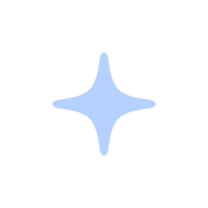

<p align="center">
  <picture>
    <source media="(prefers-color-scheme: light)" srcset="docs/assets/icon-light.png">
    
  </picture>
</p>

# Sirius

Talk to your agents from anywhere on your Mac. Hold `fn` and say what you want, or press ⌘⇧J to type it, and your agent gets to work in its own folder. When it has something to tell you, the reply comes back as a small toast, a notification or a spoken line, so you can keep doing what you were doing.

Sirius is bring your own harness (BYOH). It has no model of its own: it drives the agent CLI you already have installed and signed in, with your account, your settings and your folders. Claude Code, ChatGPT / Codex and Muse Code work out of the box, and any other harness is one adapter away ([§6](#6-bring-your-own-harness-byoh)).

## 1. Install

Download [Sirius](https://trysirius.app/download), drag Sirius to Applications, and open it. It lives in the menu bar.

Requires macOS 14+ on Apple Silicon. Sirius is signed and notarized, so the permissions you grant survive updates.

## 2. First run

Setup is one sheet.

- **Shortcuts.** Hold `fn` to talk and ⌘⇧J to compose; click either to change it.
- **Permissions.** Allow the microphone, so Sirius can hear you while you hold `fn`, and Accessibility, so it can see the key and paste text. Each has its own Allow button; nothing is asked for unannounced. If Parrot is running, quit it so `fn` isn't handled twice.
- **Workspaces.** Sirius looks for `claude`, `codex` and `muse` on your PATH, and for the copy of Codex inside ChatGPT.app. Each agent works in the folder its own CLI most recently used among those you already trust (each harness keeps its own list of trusted folders), and the sheet says so in one line. Change opens the list of agents; click one to pick another workspace. If neither has a trusted folder, the line's Choose opens the same list.

Get Started is enabled once both permissions are allowed and an agent has a workspace. Then hold `fn` and say, "Hello, what can you do?", or press ⌘⇧J to type instead.

Sirius needs one of Claude Code 2.1.71 or later, Codex 0.132.0 or later, or Muse Code 1.4.14 or later. If yours is older, a toast tells you to update it.

## 3. Usage

- **Hold `fn` and speak** to send what you said to an agent. Start with its name ("Claude, …", "Codex, …" or "Muse, …") to pick one; otherwise it goes to the agent last chosen in the composer.
- **Hold ⌃ and `fn`** to paste what you said at the cursor instead, in any app.
- **Press ⌘⇧J** to open the composer. The current agent shows beside the send button, and ⌘/ switches to the next one. With the composer open, `fn` dictates into it, so you can edit before sending.

Speech recognition runs on your Mac. The first start downloads the speech model (about 145 MB); if you already use Parrot, Sirius reuses its model and your dictionary at `~/.config/parrot/dictionary`.

Both shortcuts can be changed in **Settings…** from the menu-bar icon. The compose shortcut can be any key with ⌘, ⌃ or ⌥, or an F-key. The hold key can be `fn`, right ⌥, right ⌘ or ⌃; with ⌃ as the hold key, ⌃⇧ pastes at the cursor.

The first time an agent sends a notification, macOS asks whether Sirius may show them.

## 4. Updates

Sirius updates itself. It checks once a day, tells you when a new version is ready, and installs it when you click. **Check for Updates…** in the menu checks now.

## 5. Build from source

```sh
swift build && swift test
scripts/dev-install.sh      # build, sign, and install Sirius.app
```

`scripts/build-app.sh` builds `build/Sirius.app` on its own. Both sign with the Developer ID in your keychain if there is one; without one the app is ad-hoc signed, and macOS forgets its permissions on every rebuild. The design is in [docs/architecture.md](docs/architecture.md).

## 6. Bring your own harness (BYOH)

A harness is an agent CLI that can hold a session without its terminal UI: Claude Code, Codex and Muse Code today. Each one is an agent in Sirius, described by `~/.agents/registry/<agent>/agent.json`, whose `harness` field picks the adapter that runs it. The adapter is the only code written per harness. The composer, dictation, toasts, asides and the log are the same for all of them.

Adding one is a change to the source, in five steps:

1. **Name it.** Add a case to `AgentRegistration.Harness` in `Sources/SiriusProtocol/Registration.swift`. Its raw value is what `agent.json` says. The switches over the harness are exhaustive, so the compiler then points to the other places to fill in.
2. **Write the adapter** in `Sources/SiriusAdapters/`, implementing `Adapter` (`Sources/SiriusCore/Adapter.swift`): `open` starts the CLI warm in the agent's folder, resuming a session when given one, with `SIRIUS_SOCKET` in its environment and the agent's instructions; `prompt` delivers one message as a turn and returns when the turn ends; `close` stops it. `steer` (join a running turn) and `compact` are optional: declare them in the capabilities `open` returns, and Sirius calls only what you declared. If the CLI speaks JSON-RPC over stdio, as Codex and Muse do, `JSONRPCStdio` is the transport.
3. **Give the agent its way back.** The agent reaches you by calling Sirius, never by its own output: the `sirius` command, or the `sirius-mcp` server for a harness that takes MCP servers. The adapter puts one of them within the session's reach.
4. **Return it** from `AgentHost.makeDefaultAdapter` in `Sources/SiriusAdapters/AgentHost.swift`.
5. **Add it to setup.** The command to look for (`AgentDetector`), its names and effort levels (`Sources/SiriusApp/Setup/AgentChoice.swift`), where it keeps its trusted folders (`TrustedFolders`), and its mark at `packaging/marks/<harness>.svg`.

`Sources/SiriusAdapters/Muse/` is the shortest complete example, and its tests in `Tests/SiriusAdaptersTests/` run against a fake server and recorded streams, with no account. Check yours with `swift test`, then `scripts/dev-install.sh`. The adapters' shared jobs are described in [docs/architecture.md](docs/architecture.md) §5. Pull requests for new harnesses are welcome.

## 7. License

Apache-2.0. See [LICENSE](LICENSE) and [NOTICE](NOTICE).

## 8. Reporting bugs

Open an issue at [github.com/humanitas-labs/sirius/issues](https://github.com/humanitas-labs/sirius/issues) and attach `~/Library/Logs/Sirius/sirius.log`. The log records what Sirius did, not what you said.
